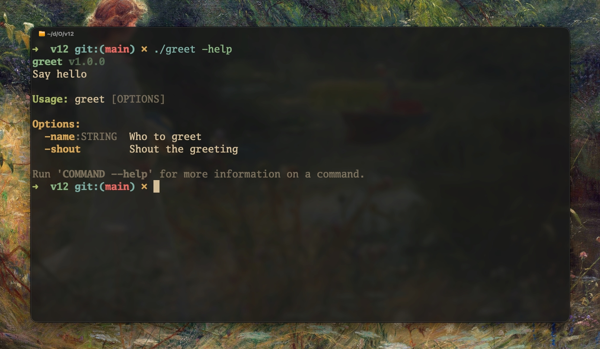

# reflags

<div align="center" style="">
    
</div>

Builder-style command-line argument parser for [Odin](https://odin-lang.org).

Define commands, options, and positional arguments declaratively, then parse `os.args` against them. Subcommands, typed values, defaults, variadic args, aliases, colored help — all without leaving Odin.



```odin
import reflags "pkgs:reflags"
```

> Requires Odin `dev-2025-09` or newer.

---

## Features

- **Commands & nested subcommands** with aliases and per-command handlers
- **Typed options and arguments** — `string`, `int`, `float`, `bool`, `path`, `enum`, `custom`
- **Two parsing styles** — Unix (`--flag`, `--flag=value`, `-abc`) and Odin (`-flag`, `-flag:value`, `-no_git` → `no-git`)
- **Builder API** and one-liner convenience constructors (`opt_flag`, `opt_str`, `arg_int`, ...)
- **Defaults, required flags, variadic & multiple values**, hidden commands/options
- **Notes** on commands/options/arguments surfaced in help
- **Auto-generated help and version output** with ANSI colors (disable with `make_cli_no_color`)
- No external dependencies — just `core:`.

---

## Installation

Copy or vendor the `reflags/` directory into your project, then import it:

```odin
import reflags "path/to/reflags"
```

If you use `mimir` / git submodules / `odin` collections, add it to your collection path (e.g. `pkgs:reflags`).

---

## Quick Start

Minimal `greet` CLI — one string option, one boolean flag:

```odin
package main

import "core:fmt"
import "core:os"
import "core:strings"
import reflags "path/to/reflags"

main :: proc() {
    root := reflags.command("greet", "Say hello")
    append(&root.options, reflags.opt_str("name", "n", "Who to greet"))
    append(&root.options, reflags.opt_flag("shout", "s", "Shout the greeting"))

    // CLI must outlive parse, so root lives on the heap
    root_ptr := new(reflags.Command)
    root_ptr^ = root

    cli := reflags.make_cli("greet", "1.0.0", root_ptr)

    parsed := reflags.parse_or_exit(&cli, os.args[1:])
    defer reflags.destroy(parsed)

    name  := reflags.get_string(parsed, "name")
    shout := reflags.get_bool(parsed, "shout")

    greeting := fmt.tprintf("Hello, %s!", name)
    if shout {
        greeting = strings.to_upper(greeting, context.temp_allocator)
    }
    fmt.println(greeting)
}
```

```sh
./greet -name Alice
# Hello, Alice!

./greet -name Alice -shout
# HELLO, ALICE!

./greet -help
# greet v1.0.0
# Usage: greet [OPTIONS]
# Options:
#   -name:STRING   Who to greet
#   -shout         Shout the greeting
```

For subcommands, handlers, and a fuller layout see [`examples/quickstart/`](examples/quickstart/) and [`examples/cargo_like/`](examples/cargo_like/).

---

## Defining a CLI

### Commands

```odin
// Direct construction
root := reflags.command("myapp", "A sample CLI application")
root.long_desc = "Longer description shown in --help output."
root.alias = "m"                          // alternative name
append(&root.notes, "Only works inside a project dir.")

// Builder style (same result)
b := reflags.command_builder("myapp", "A sample CLI application")
reflags.cmd_long_desc(&b, "Longer description shown in --help output.")
reflags.cmd_note(&b, "Only works inside a project dir.")
reflags.cmd_set_aliases(&b, "m")
reflags.cmd_hide(&b)                      // hide from listings
reflags.cmd_set_handler(&b, my_handler)
reflags.cmd_add_option(&b, reflags.opt_flag("verbose", "v", "Verbose output"))
reflags.cmd_add_argument(&b, reflags.arg_string("path", "Project path"))
reflags.cmd_add_subcommand(&b, build_cmd)
root := reflags.cmd_build(b)
```

Attach subcommands by appending to `Command.subcommands` or via `cmd_add_subcommand`. Handlers are `proc(args: Parsed_Args) -> ^Error`.

Add the standard `--help`/`--version` flags with `help_option()`, `version_option()`, `global_options()`, or `add_global_options(&builder)`. Common build flags are available as `verbose_option`, `quiet_option`, `color_option()`, and `build_options()`.

### Options

Two styles — convenience one-liners or step-by-step builder:

```odin
// One-liners (short may be "")
reflags.opt_flag("verbose", "v", "Verbose output")
reflags.opt_str("output", "o", "Output file")
reflags.opt_str_req("input", "i", "Input file")   // required
reflags.opt_int("jobs", "j", "Parallel jobs")
reflags.opt_int_req("count", "c", "Required count")
reflags.opt_float("scale", "", "Scale factor")
reflags.opt_path("config", "c", "Path to config")
reflags.opt_enum("color", "", "Color mode", {"auto","always","never"}, "auto")
reflags.opt_custom("point", "", "A point", parse_point)

// Step-by-step builder
ob := reflags.option("jobs", "Number of parallel jobs")
reflags.opt_short(&ob, "j")
reflags.opt_type(&ob, reflags.int_type)
reflags.opt_default(&ob, "4")
reflags.opt_required(&ob)
reflags.opt_multiple(&ob)        // allow repeated, comma-joined
reflags.opt_hidden(&ob)          // hide from help
reflags.opt_note(&ob, "Defaults to number of CPUs")
opt := reflags.opt_build(ob)
```

For already-built `Option` values, `option_note(&opt, "note")` and `command_note(&cmd, "note")` append notes without a builder.

### Arguments (positionals)

```odin
// One-liners (all required by default)
reflags.arg_string("src", "Source file")
reflags.arg_int("count", "How many")
reflags.arg_float("ratio", "Ratio")
reflags.arg_path("out", "Output path")
reflags.arg_bool("force", "Force flag as positional")
reflags.arg_enum("mode", "Build mode", {"debug","release"})

// Builder — optional, variadic, hidden, notes, custom type
ab := reflags.argument("args", "Extra args forwarded to binary")
reflags.arg_optional(&ab)        // not required
reflags.arg_variadic(&ab)        // consumes all remaining positionals (implies optional)
reflags.arg_hidden(&ab)
reflags.arg_type(&ab, reflags.int_type)
reflags.arg_note(&ab, "Pass after -- to avoid flag parsing")
arg := reflags.arg_build(ab)
```

Arguments are matched in declaration order. The last argument may be `variadic` to collect the remainder.

### Value Types

`Arg_Type_Info` describes how a raw string is parsed. Use the presets or construct your own:

| Preset / Constructor | `Arg_Type` | Notes |
|---|---|---|
| `string_type` | `String` | Any string |
| `int_type` | `Int` | Decimal integer |
| `float_type` | `Float` | `f64` |
| `bool_type` | `Bool` | Flag — presence means `true`; no value accepted |
| `path_type` | `Path` | String (path validation is up to you) |
| `enum_type({"a","b"})` | `Enum` | Restricted to listed values; heap-copied |
| `custom_type(proc)` | `Custom` | Delegate to `proc(_: string) -> (any, ^Re_Error)` |

Set with `opt_type(&builder, type)` / `arg_type(&builder, type)`.

---

## Parsing

### CLI descriptor

```odin
root_ptr := new(reflags.Command)
root_ptr^ = root

cli := reflags.make_cli("myapp", "1.0.0", root_ptr)          // color on
cli := reflags.make_cli_no_color("myapp", "1.0.0", root_ptr) // color off

cli.style = .Odin   // default
cli.style = .Unix
```

| `Parsing_Style` | Long flag | Value syntax | Short / bundling | Underscore handling |
|---|---|---|---|---|
| `.Odin` (default) | `-flag` | `-flag:value` (required for non-bool) | No short flags; single dash only | `-no_git` matches `no-git` |
| `.Unix` | `--flag`, `-s` | `--flag=value`, `--flag value`, `-ovalue`, `-o=value` | Bundled `-abc` | — |

Both styles treat `--` as end-of-options — everything after is positional.

### Parse entry points

```odin
// Returns result or error — caller handles help/version/exit
parsed, err := reflags.parse(&cli, os.args[1:])
if err != nil {
    reflags.print_error(&cli, err)
    if err.reason == .Help_Requested || err.reason == .Version_Requested {
        os.exit(0)
    }
    os.exit(1)
}
defer reflags.destroy(parsed)

// Convenience — prints and exits on error, otherwise returns result
parsed := reflags.parse_or_exit(&cli, os.args[1:])
defer reflags.destroy(parsed)
```

`strict` (third arg to `parse`, default `true`) is reserved for future use.

`Parsed_Args` holds `command` (the matched command), `values` (name → string), `positionals`, and `raw_args`. Free it with `destroy`.

### Reading values

```odin
reflags.get_string(parsed, "name", "default")
reflags.get_int(parsed, "jobs", 1)
reflags.get_float(parsed, "scale")
reflags.get_bool(parsed, "verbose")
reflags.get_enum(parsed, "color")   // -> (string, bool)
reflags.get_strings(parsed, "args") // splits comma-joined multiple/variadic
```

`get_strings` is the right accessor for `opt_multiple` and `variadic` arguments.

### Handlers

```odin
build_handler :: proc(args: reflags.Parsed_Args) -> ^reflags.Error {
    release := reflags.get_bool(args, "release")
    // ...
    if something_failed {
        return reflags.make_error(.Parse_Error, "build failed")
    }
    return nil
}
build_cmd.handler = build_handler

// Dispatch after parse:
if parsed.command.handler != nil {
    if err := parsed.command.handler(parsed); err != nil {
        reflags.print_error(&cli, err)
        os.exit(1)
    }
}
```

Returning `Help_Requested` / `Version_Requested` from a handler triggers help/version output.

### Errors

`Error_Reason`: `None`, `Unknown_Command`, `Unknown_Option`, `Missing_Required_Option`, `Missing_Required_Argument`, `Invalid_Value`, `Extra_Arguments`, `Parse_Error`, `Help_Requested`, `Version_Requested`.

Construct with `make_error(reason, message, command?, option?)`.

Output helpers:

| Proc | Description |
|---|---|
| `print_error(cli, err)` | Help/version to stderr, else styled `"<name> error: <msg>"` + `Run '… --help' for usage.` |
| `print_help(cli, out, cmd?)` | Full help page |
| `print_usage(cli, out, cmd?)` | Compact usage |
| `print_version(cli, out)` | `"<name> v<version>"` |
| `command_error(prefix, msg)` | Styled `"<prefix> error: <msg>"` to stderr |
| `error_hint(cmd)` | `Run '<cmd> -help' for usage.` (Odin style) |
| `error_hint_unix(cmd)` | `Run '<cmd> --help' for usage.` (Unix style) |
| `success(msg)` | Bold green to stdout |
| `warning_msg(out, msg)` | Bold yellow |
| `info_msg(out, msg)` | Bold blue |
| `error_output(msg)` | Bold red to stderr |

---

## Help Output

Help is rendered with colors when `CLI.color_enabled` is true (ANSI escapes are blank otherwise). Sections: header (`name v<version>`), description / `long_desc`, `Usage:` line, `Options:`, `Arguments:`, `Commands:`, and per-item notes:

```
myapp v1.0.0
A sample CLI application demonstrating reflags features.

Usage: myapp [OPTIONS] <COMMAND>

Options:
  -verbose         Use verbose output
  -color:STRING    Coloring: auto, always, never (default: auto)

Commands:
  build    Compile the project
  run      Build if needed, then run the project
  test     Run the test suite

Run 'COMMAND -help' for more information on a command.
```

Customize with `Command.long_desc`, `Command.notes`, `Option.notes`, `Argument.notes`, `hidden`, and `style_set` / `make_style` / `get_style` if you need low-level styling.

---

## Examples

| Example | Description | Style |
|---|---|---|
| [`examples/hello_world/`](examples/hello_world/) | Single command, `--name` + `--shout` | Unix |
| [`examples/quickstart/`](examples/quickstart/) | `myapp` with `build`/`run`/`test`, aliases, variadic args, notes, handlers | Odin |
| [`examples/cargo_like/`](examples/cargo_like/) | Cargo-inspired CLI with shared/common options | Unix |

Run one:

```sh
odin run examples/hello_world -- -help
odin run examples/quickstart -- build -help   # Unix style would be --help
odin run examples/cargo_like -- -help
```

> `quickstart` uses `cli.style = .Odin`, so flags are `-release`, `-jobs:4`, `-filter:value`, and `--` separates positionals.

---

## Project Layout

```
reflags/
├── builder.odin   — option/argument/command/CLI builders & convenience ctors
├── types.odin     — Arg_Type, Option, Argument, Command, Parsed_Args, CLI, colors, get_*/destroy
├── parsing.odin   — parse / parse_or_exit, Unix + Odin parsers, validation
├── output.odin    — print_help/usage/version/error, section writers, style_set
├── docs.odin      — package overview (odin doc)
└── examples/
    ├── hello_world/
    ├── quickstart/
    └── cargo_like/
```

---

## License

Same as the enclosing repository. If none is specified, treat as MIT.
